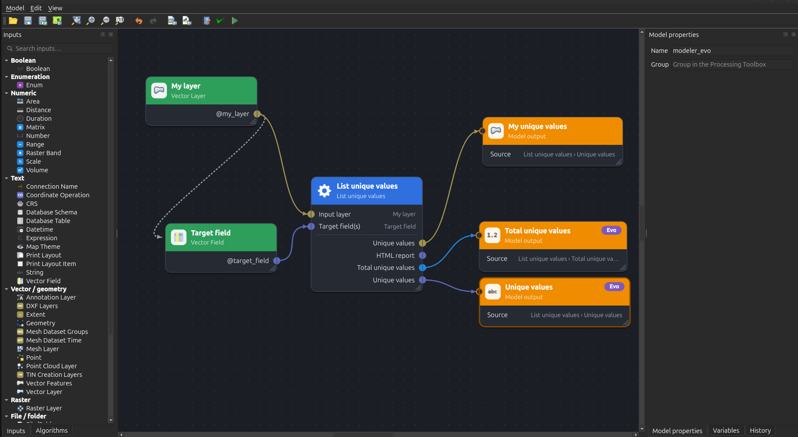

# ModelerEvo

🇫🇷 [Version française](README_FR.md)

Modernized version of the Processing graphical modeler for QGIS.



Models keep the `.model3` format and are **100% compatible** with the original modeler: a model
created or edited with ModelerEvo opens in the QGIS modeler, and vice versa.

> **Status: experimental (0.1.0).** Back up your models before editing them.

## Features

- **Resizable nodes** with a colored header: inputs (green), algorithms (blue), model outputs
  (orange); title, subtitle (input type, algorithm or model name) and list of inputs / outputs in the
  node body
- **Icon for each type** of input and output, gear wheel for algorithms
- **Typed connection points**, colored by category; drag-and-drop connections with highlighting of
  the compatible targets
- **Arrows**: direct relation (solid line), expression (dashed), dependency (dotted)
- **Double-click settings**: Properties, Comments and Help tabs
- Colored **comments** and **group boxes**
- **Help for each node**, shown on hover and included in the model help window
- **Extended outputs** `[Evo]`: algorithm outputs not bound to a parameter (number, text, HTML…)
- Undo / redo, zoom, snapping to grid, **dark theme**
- Docks: inputs, algorithms (search, drag and drop), properties, variables
- Validation, execution (F5), saving to a file or into the project
- Exports: image, PDF, SVG, Python script

### "Evo" badge

Features that do not exist in the original modeler carry the **Evo** badge. They are saved in the
`.model3` without making it invalid, but the original modeler ignores them.

## Compatibility

- QGIS 3.34 to 4.x
- Qt5 and Qt6

## Languages

The interface follows the QGIS language: **English** (default for any other language) and
**French**. Translations are Qt Linguist files in `i18n/`. To add one, for example German:

```bash
python3 tools/update_translations.py --add de   # creates i18n/modeler_evo_de.ts
linguist i18n/modeler_evo_de.ts                 # translate (or edit the .ts file directly)
python3 tools/update_translations.py            # compiles the .qm file
```

## Installation

### From a release (recommended)

1. Download the plugin ZIP from the
   [releases](https://github.com/naub1n/QGIS-ModelerEvo/releases) page.
2. In QGIS: *Plugins → Manage and Install Plugins → Install from ZIP*.
3. Enable experimental plugins in the plugin manager settings, then activate **ModelerEvo**.

### From the source code

Clone the repository into the plugins folder of your QGIS profile, under the name `modeler_evo`:

```bash
cd …/profiles/default/python/plugins
git clone https://github.com/naub1n/QGIS-ModelerEvo.git modeler_evo
```

## Usage

- **Plugins → ModelerEvo** menu, toolbar icon, or **Processing** menu
- In the Processing Toolbox: right-click a model → **Edit with ModelerEvo…**
  (QGIS 3, and QGIS ≥ 4.4)

## Reporting issues

Bugs and suggestions can be reported in the
[issues](https://github.com/naub1n/QGIS-ModelerEvo/issues).

## Use of AI

This plugin was built with the help of artificial intelligence:
[Claude Code](https://claude.com/claude-code) (Anthropic) was used as an assistant to write the code
and the documentation. The design, specifications, functional choices and testing in QGIS were done
by the author.

## License

Distributed under the [GNU GPL v3.0](LICENSE) or later.
